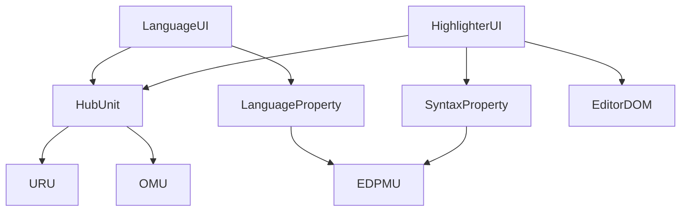

# ArcD — OCDA P2

## New objects / properties
- Object: LanguageUI, HighlighterUI.
- Properties: Language, SyntaxHighlight, HighlightShortcut,
  HighlightPerformance, Version.

## Event chain list
- Locale click → LanguageUI → HubUnit Request → OMU Log → EDPMU.
- Enable click → HighlighterUI → HubUnit Request → OMU Log → EDPMU.
- Unknown registration → HubUnit → URU auto-registration → OMU.

## EHU table
| Condition | Origin | Code | Handling |
| --- | --- | --- | --- |
| Invalid registration | URU | 400 | EHU/FAIL |
| Unsupported locale | LanguageUI | 400 | FAIL result |
| Unsupported relation | HubUnit | TBD | Not enforced yet |

## Relationship tests
Browser PASS/FAIL and dependency matrix validation are pending.
