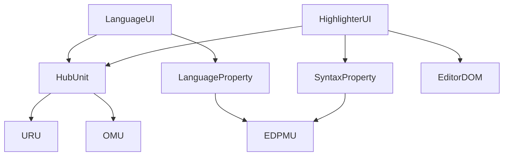

# ArcD — OCDA P2

## New objects / properties
- Object: LanguageUI, HighlighterUI.
- Properties: Language, SyntaxHighlight, HighlightShortcut,
  HighlightPerformance, Version.

## Event chain list
- Locale click → LanguageUI → HubUnit Request → OMU Log → EDPMU.
- Enable click → HighlighterUI → HubUnit Request → OMU Log → EDPMU.
- Unknown registration → HubUnit → URU auto-registration → OMU.

## EHU table
| Condition | Origin | Code | Handling |
| --- | --- | --- | --- |
| Invalid registration | URU | 400 | EHU/FAIL |
| Unsupported locale | LanguageUI | 400 | FAIL result |
| Unsupported relation | HubUnit | TBD | Not enforced yet |

## Relationship tests
Browser PASS/FAIL and dependency matrix validation are pending.

## P3 update
- Version synchronized to OCDA-P3 across bootstrap and HTML.
- Menu state and editor fallback improved; browser E2E pending.

## P6 — Event chain / architecture / EHU
- Chain: Bootstrap.fetchManifest -> ImportMap.install -> app.import -> LinkCore.publishVersion -> URU.register(Version) -> EDPMU.set(Version) -> OMU.record(VERSION_PUBLISHED,200).
- New release property: `LinkCore/release.json` is the only version declaration; bootstrap resolves module import URLs.
- EHU: missing release -> VERSION_MISSING/500; bootstrap fetch failure -> console and document error marker (OMU not yet initialized).
- Relation: bootstrap initializes LinkCore before UI object construction; no direct version reads from UI modules.

## P7 — Palette architecture
- New Object: PaletteUI; new Property: UIPalette / palette.js.
- Chain: paletteBtn.click -> PaletteUI.open -> Hub.dispatch -> OMU; color.input -> PaletteUI.setHex -> Hub.dispatch -> EDPMU.set -> CSS vars -> localStorage.
- Abstract: PaletteUI -> HubUnit -> {URU,OMU,EDPMU} -> UIPalette -> DOM style.
- EHU: invalid input 400, missing dialog 404, dialog exception 500, persistence error STORAGE_FAILED.
- Relation tests: open/close, invalid hex, RGB input, mode switching, reload persistence and log records; browser tests pending.

## P8
- Objects: ChunkLoaderUI; Property: ChunkLoading and 64 KiB chunk algorithm.
- Event chain: Open -> FileInput -> ChunkLoaderUI.load -> Hub -> Chunk Property -> EditorUI; Palette endpoint -> Hub -> UIPalette -> CSS tokens.
- EHU cases: invalid file 400, cancellation 409, read failure 500; current failure logging is incomplete.
- Relation tests: toggle, dark 0, light 255, small file, >1 MiB file, cancellation, persistence; browser execution pending.

## P9 — Objects and EHU
- Object: FileOperationsUI; Property: FileState; default ChunkLoading always on.
- Event chain: Menu -> FileOperationsUI -> Hub -> OMU/EDPMU; Open -> ChunkLoaderUI -> ChunkLoading -> FileOperationsUI.
- Error cases: SAVE_NO_FILE 400; SAVE_PARTIAL_BLOCKED 409; CLOSE_CANCELLED 409; loader failure 500.
- Relation test: request PASS/FAIL and log records; browser verification pending.

## P10 — Objects / event chain / EHU
- New object EditorViewportUI; new property VisibleLineRange.
- Diagram: UI wheel -> EditorViewportUI -> ChunkLoaderUI -> chunkLoading.readWindow -> FileOperationsUI.receive -> EditorUI; save -> FileOperationsUI.assemble -> Blob download.
- LinkCore: Hub records WINDOW_START, WINDOW_READY, OPEN_WINDOW and SAVE_DOWNLOAD_REQUESTED; EDPMU stores FileState and VisibleLineRange.
- EHU: WINDOW_FAILED (409/500), SAVE_ASSEMBLY_FAILED (500), SAVE_NO_FILE (400).
- Relation tests: sequential next/previous, patch preservation, full Blob export, line count and status percentage. Pending browser verification.

## P11
- Objects: existing ChunkLoaderUI and EditorViewportUI; properties ChunkLoading and VisibleLineRange.
- Event chain: window navigate -> Hub -> ChunkLoaderUI -> Footer meter/status; input/scroll -> EditorViewportUI -> VisibleLineRange.
- EHU: WINDOW_FAILED 409/500; tests pending for progress states, line offsets, scrollbar and export integrity.

## P12 — Object and relation architecture
- New object FileTabsUI; property OpenFileTabs.
- Event chain: FileInput -> ChunkLoaderUI -> FileOperationsUI -> FileTabsUI -> HubUnit/OMU/EDPMU; Tab select -> FileTabsUI -> FileOperationsUI.restore.
- EHU: tab ID missing 404 FAIL; loader WINDOW_FAILED 409/500; requested window progress UI uses busy/success/error.
- Relation test cases: open A/B, edit A, switch B, return A, export A, close B, compare byte hash; pending execution.
