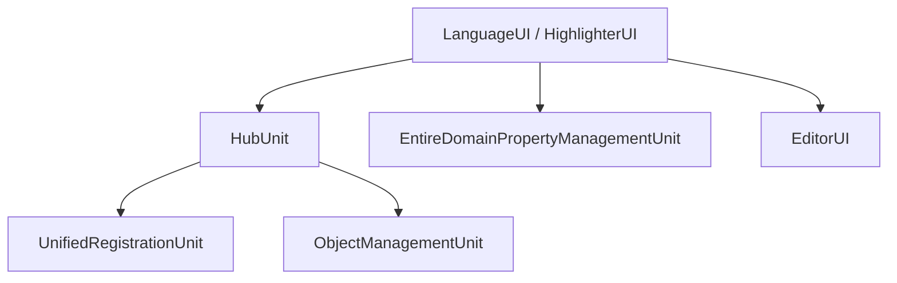

# ArcD — OCDA-P1

## Event chain
UI action → Hub.dispatch → URU auto-register if needed → OMU log → property update.

## EHU table
| Error | Source | Target | Action |
| --- | --- | --- | --- |
| INVALID_REGISTRATION | URU | OMU | EHU / REGISTER |

## Limitations
Full relation code and cross-object authorization are not yet enforced.
