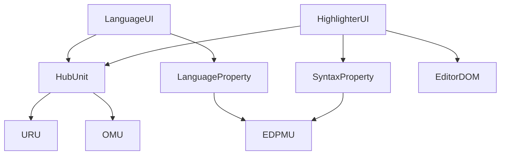

# ArcD — OCDA P2

## New objects / properties
- Object: LanguageUI, HighlighterUI.
- Properties: Language, SyntaxHighlight, HighlightShortcut,
  HighlightPerformance, Version.

## Event chain list
- Locale click → LanguageUI → HubUnit Request → OMU Log → EDPMU.
- Enable click → HighlighterUI → HubUnit Request → OMU Log → EDPMU.
- Unknown registration → HubUnit → URU auto-registration → OMU.

## EHU table
| Condition | Origin | Code | Handling |
| --- | --- | --- | --- |
| Invalid registration | URU | 400 | EHU/FAIL |
| Unsupported locale | LanguageUI | 400 | FAIL result |
| Unsupported relation | HubUnit | TBD | Not enforced yet |

## Relationship tests
Browser PASS/FAIL and dependency matrix validation are pending.

## P3 update
- Version synchronized to OCDA-P3 across bootstrap and HTML.
- Menu state and editor fallback improved; browser E2E pending.

## P6 — Event chain / architecture / EHU
- Chain: Bootstrap.fetchManifest -> ImportMap.install -> app.import -> LinkCore.publishVersion -> URU.register(Version) -> EDPMU.set(Version) -> OMU.record(VERSION_PUBLISHED,200).
- New release property: `LinkCore/release.json` is the only version declaration; bootstrap resolves module import URLs.
- EHU: missing release -> VERSION_MISSING/500; bootstrap fetch failure -> console and document error marker (OMU not yet initialized).
- Relation: bootstrap initializes LinkCore before UI object construction; no direct version reads from UI modules.

## P7 — Palette architecture
- New Object: PaletteUI; new Property: UIPalette / palette.js.
- Chain: paletteBtn.click -> PaletteUI.open -> Hub.dispatch -> OMU; color.input -> PaletteUI.setHex -> Hub.dispatch -> EDPMU.set -> CSS vars -> localStorage.
- Abstract: PaletteUI -> HubUnit -> {URU,OMU,EDPMU} -> UIPalette -> DOM style.
- EHU: invalid input 400, missing dialog 404, dialog exception 500, persistence error STORAGE_FAILED.
- Relation tests: open/close, invalid hex, RGB input, mode switching, reload persistence and log records; browser tests pending.
